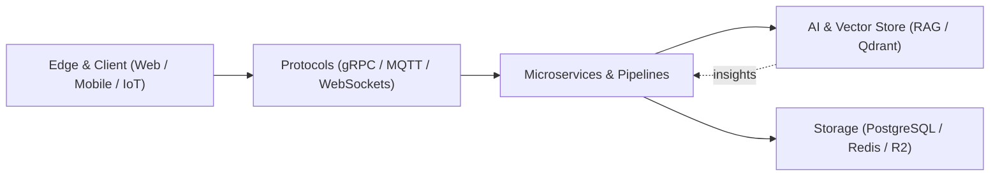

<div align="center">


[](https://git.io/typing-svg)

<p>
  <a href="mailto:vutranquangminh.dev@gmail.com"></a>
  <a href="https://www.linkedin.com/in/vutranquangminh"></a>
  <a href="https://github.com/vutranquangminh"></a>
  
</p>

```text
📍 Ho Chi Minh City, Vietnam  ·  🧠 Full-Stack & Edge-to-Cloud  ·  🤖 Multi-LLM & RAG Systems
```

</div>

## `> whoami`

Full-Stack Software Engineer specialized in architecting **secure, high-concurrency solutions** across AI Healthcare, Smart Retail IoT, and Enterprise Commerce. Experienced in delivering end-to-end production systems — from multi-provider LLM/RAG pipelines and microservices to responsive dashboards and cross-platform mobile apps.



## `> experience.log`

| Timeline                | Role                       | Company           |
| :---------------------- | :------------------------- | :---------------- |
| **Oct 2026 — Present**  | Full Stack Engineer        | **NewEra Inc**    |
| **Jan 2026 — Sep 2026** | Full Stack Engineer        | **TMA Solutions** |
| **Oct 2025 — Dec 2025** | Frontend Developer Intern  | **TMA Solutions** |
| **Jul 2025 — Sep 2025** | Full Stack Engineer Intern | **Plogg Vietnam** |
| **Apr 2025 — Jun 2025** | Back-End Developer Intern  | **Apps Cyclone**  |

## `> toolchain.manifest`

<div align="center">

### Languages & runtimes


### Frameworks & UI


### Data, messaging & AI


### Cloud, storage & DevOps


</div>

## `> publications & research`

- 📄 **VALF: A CLA-based Reinforcement Learning Framework for Vietnamese Language Learning in Dyslexic Children**  
  _International Journal of Computer Applications (IJCA) · Published Aug 20, 2025_

## `> education --timeline`

| Timeline                | Degree                                                  | University                                |
| :---------------------- | :------------------------------------------------------ | :---------------------------------------- |
| **Aug 2026 — Jun 2028** | Master of Science (M.Sc.), Computer Science             | Ho Chi Minh City University of Technology |
| **Aug 2022 — Feb 2026** | Bachelor of Science (B.Sc.), Computer Science · GPA 3.6 | University of Greenwich                   |

## `> github --signal`

<div align="center">

### Contribution trail

<picture>
  <source media="(prefers-color-scheme: dark)" srcset="https://raw.githubusercontent.com/vutranquangminh/vutranquangminh/output/github-contribution-grid-snake-dark.svg">
  
</picture>

### Let's build something exceptional.


</div>
