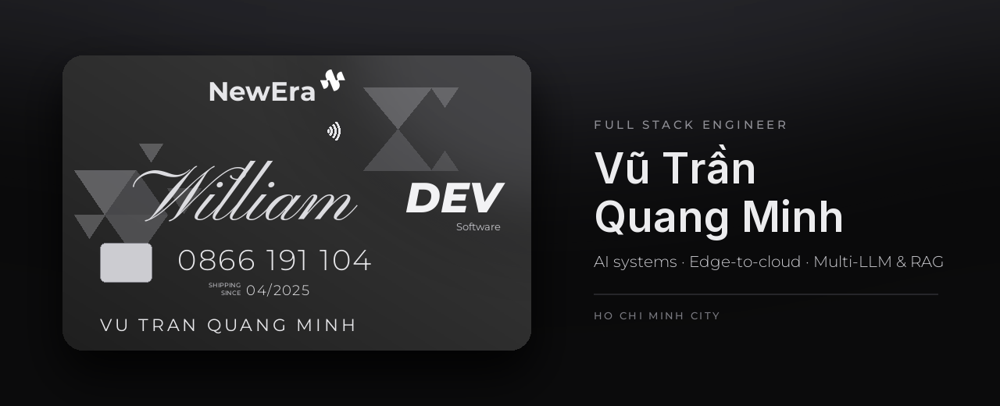
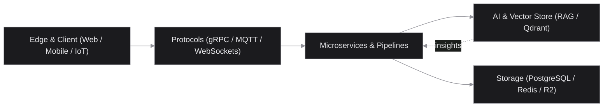

  
  
  
  

HO CHI MINH CITY &nbsp;·&nbsp; FULL-STACK &amp; EDGE-TO-CLOUD &nbsp;·&nbsp; MULTI-LLM &amp; RAG SYSTEMS

 

## ABOUT

Full-Stack Software Engineer specialized in architecting **secure, high-concurrency solutions** across AI Healthcare, Smart Retail IoT, and Enterprise Commerce. Experienced in delivering end-to-end production systems, from multi-provider LLM/RAG pipelines and microservices to responsive dashboards and cross-platform mobile apps.

## EXPERIENCE

| Timeline                | Role                       | Company           |
| :---------------------- | :------------------------- | :---------------- |
| **Oct 2026 — Present**  | Full Stack Engineer        | **NewEra Inc**    |
| **Jan 2026 — Sep 2026** | Full Stack Engineer        | **TMA Solutions** |
| **Oct 2025 — Dec 2025** | Frontend Developer Intern  | **TMA Solutions** |
| **Jul 2025 — Sep 2025** | Full Stack Engineer Intern | **Plogg Vietnam** |
| **Apr 2025 — Jun 2025** | Back-End Developer Intern  | **Apps Cyclone**  |

## TOOLCHAIN

LANGUAGES &amp; RUNTIMES 

FRAMEWORKS &amp; UI 

DATA, MESSAGING &amp; AI 

CLOUD, STORAGE &amp; DEVOPS 

## PUBLICATIONS

**[VALF: A CLA-based Reinforcement Learning Framework for Vietnamese Language Learning in Dyslexic Children](https://www.ijcaonline.org/archives/volume187/number29/valf-a-cla-based-reinforcement-learning-framework-for-vietnamese-language-learning-in-dyslexic-children/)**  
INTERNATIONAL JOURNAL OF COMPUTER APPLICATIONS (IJCA) &nbsp;·&nbsp; PUBLISHED AUG 20, 2025

## EDUCATION

| Timeline                | Degree                                                  | University                                |
| :---------------------- | :------------------------------------------------------ | :---------------------------------------- |
| **Aug 2026 — Jun 2028** | Master of Science (M.Sc.), Computer Science             | Ho Chi Minh City University of Technology |
| **Aug 2022 — Feb 2026** | Bachelor of Science (B.Sc.), Computer Science · GPA 3.6 | University of Greenwich                   |

## ACTIVITY

<picture>
  <source media="(prefers-color-scheme: dark)" srcset="https://raw.githubusercontent.com/vutranquangminh/vutranquangminh/output/github-contribution-grid-snake-dark.svg">
  
</picture>

  

**Let's build something exceptional.**

<!-- The site served from this repo (portfolio at /) is documented in docs/SITE.md. -->
